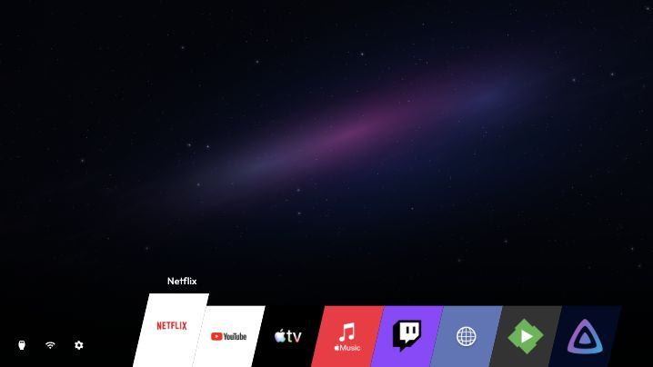

# Clean Your TV

A personal home screen for LG webOS: your apps, your order, and a configurable
dock, without sponsored rows in this launcher. It runs on the TV; your computer
can be switched off after setup. It does not remove advertisements from other
LG screens or obtain root access.

## Installation guide in your language

[English](docs/i18n/en.md) · [Deutsch](docs/i18n/de.md) · [Español](docs/i18n/es.md) ·
[Português (Brasil)](docs/i18n/pt-BR.md) · [Français](docs/i18n/fr.md) · [Italiano](docs/i18n/it.md) ·
[한국어](docs/i18n/ko.md) · [हिन्दी](docs/i18n/hi.md) · [Polski](docs/i18n/pl.md) ·
[Русский](docs/i18n/ru.md) · [简体中文](docs/i18n/zh-Hans.md) · [繁體中文](docs/i18n/zh-Hant.md).

[Try the browser demo](https://razdva122.github.io/clean-your-tv-lg-webos/) ·
[Installation guide](docs/INSTALL.md) · [Help and recovery](docs/RECOVERY.md)

*Ribbon in the 1.5.3 candidate, shown with reference apps. Apps are not bundled; TV functions are simulated.*

## Themes

Change the layout, background and app-card styling with built-in and community
themes. Manage installed themes and discover more from Settings on your TV.

**[Browse and try themes in your browser →](https://razdva122.github.io/clean-your-tv-lg-webos/)**

Use the theme cards above the simulated TV to switch themes and compare layouts,
then choose Root or No-root to preview either edition. No TV connection or
installation is needed. See the [theme guide](docs/THEMES.md) for installation
and creating your own theme.

## Download and install

> Root Home may not open automatically after standby (#171). The 1.5.3 candidate includes the Appearance scroll correction; see [changes and acceptance limits](docs/RELEASE-1.5.3.md).
> On `release/next`, the versioned metadata below describes the prepared candidate until publication. The download buttons always follow the latest published release.

<!-- release:downloads -->
Current stable release: **[v1.5.3](https://github.com/Razdva122/clean-your-tv-lg-webos/releases/tag/v1.5.3)** — [release notes](docs/RELEASE-1.5.3.md).
<!-- /release:downloads -->

1. Download the installer for your computer or an ARM64 Android phone. The buttons follow the latest published release.
2. Prepare TV access and choose No-root or Root in the wizard.
3. Install, then check Home, Back, normal controls and emergency exit before daily use.

**[Follow the installation guide →](docs/INSTALL.md)**

Windows: extract the whole ZIP before opening the app. macOS: choose Apple Silicon
or Intel to match your Mac. See [desktop instructions](docs/DESKTOP_INSTALL.md)
or [Android requirements](android/README.md) for platform details.

## Choose your edition

| Your TV setup | Edition |
| --- | --- |
| LG Developer Mode, without root | **No-root** — Home and the on-TV Home Helper. Keep Developer Mode active. |
| Existing root access and trusted root SSH | **Root** — native Home routing and independent recovery. Do not enable Developer Mode over root. |

Both use the same launcher. Compatibility depends on the model, firmware and
remote: [check requirements and known limits](docs/COMPATIBILITY.md) first.

## Everyday use

- **Home** opens your launcher while Home control is enabled.
- **Hold OK** on a tile to move or hide it; **+ / Add app** adds an installed app to the grid.
- **Press Home three times within two seconds** to stop Home control and return to LG Home. This does not erase settings.
- After an emergency exit, resume explicitly through **Home Helper** (No-root) or the Root activation control. Opening Home alone does not clear the stop.

[Remote controls](docs/CONTROLS.md) · [Arrange apps](docs/APP-MANAGEMENT.md) ·
[Update or remove](docs/MAINTENANCE.md)

## Before you rely on it

- Test results are specific to devices and versions. Read [compatibility](docs/COMPATIBILITY.md); a successful install alone does not prove daily reliability.
- The original **1.3.0 Root updater cannot install 1.4.0 through OTA**. Keep recovery records and read [the update limitations](docs/UPDATES.md) before attempting that transition.
- No-root needs an active Developer Mode session. Automatic renewal is optional Beta; continue monitoring LG's official timer.
- The on-TV **Homebrew Installer is unreleased**. Use the published computer/Android installer; [candidate details](homebrew/README.md) are for coordinated testing.

## Guides and help

[All documentation](docs/README.md) · [Guides in 12 languages](docs/LANGUAGES.md) ·
[Report a problem or a successful installation](docs/FEEDBACK.md)

If an AI agent helps with installation, it should prepare a short, redacted result
and ask your permission before posting an issue. See [instructions for agents](AGENTS.md#installation-results-and-user-consent).

For contributors: [build and technical references](docs/development/README.md),
[contributing](CONTRIBUTING.md), and [release history and test evidence](docs/history/README.md).

Versions in the stable download

<!-- release:components -->
| Component | Stable version |
| --- | --- |
| cytv installer | 0.6.1 |
| Home | 1.6.1 |
| Home Helper | 0.6.21 |
| Root edition | 0.6.2 |
| Both edition Updaters | 0.3.4 |
| Android installer / versionCode | 0.5.1 / 16 |
<!-- /release:components -->

System Updater: 1.1.2 / protocol 1 (existing supervisors stay pinned).
See the [release notes](docs/RELEASE-1.5.3.md)
and [TV acceptance and limits](docs/RELEASE-1.5.0.md).

## Credits and license

Built on [OmkarK97/webos-vibehack](https://github.com/OmkarK97/webos-vibehack)
and [Gathin23/cleanyourtv](https://github.com/Gathin23/cleanyourtv).
Not affiliated with LG. [MIT license](LICENSE) · [Third-party notices](THIRD_PARTY_NOTICES.md).
