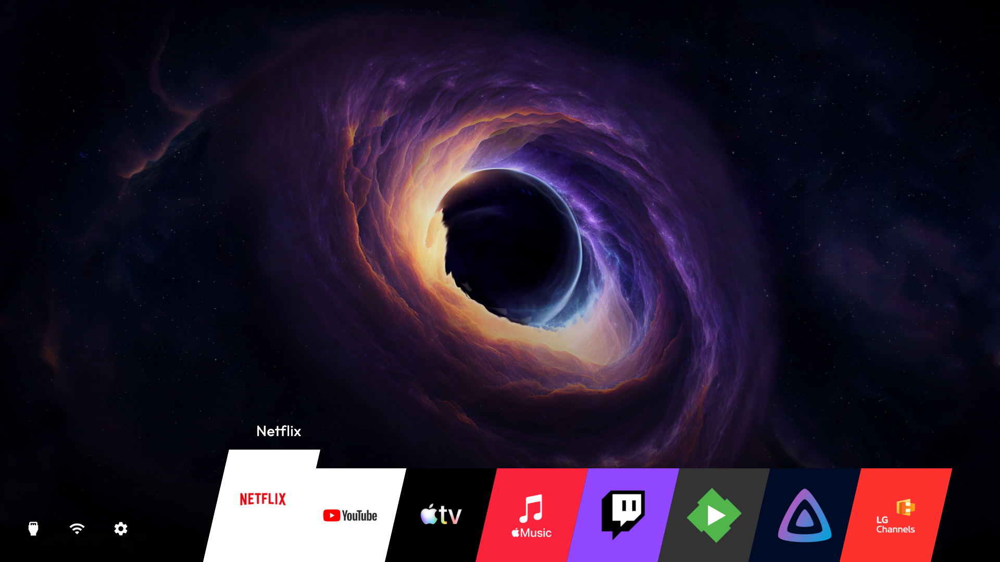

# Ribbon (bundled theme source)

Black Hole video by **Xecutioner**, native 3840×2160 with subtle original motion, compact app logos and a skewed bottom ribbon. Non-commercial use with author attribution is permitted as confirmed by the maintainer; see [license](LICENSE.txt), [credits](CREDITS.txt) and [artwork provenance](ARTWORK.md). The video is not MIT artwork.

[Try Ribbon in the browser demo](https://razdva122.github.io/clean-your-tv-lg-webos/demo/). Choose Ribbon in the theme selector. Demo functions use simulated services and reference app icons; these images are browser renders, not TV screenshots. Public demo deployment follows publication from main.

The source embeds native UHD/FHD silent video and an UHD JPEG fallback. The trusted runtime uses a continuous bounded stream for the pinned Black Hole UHD media, avoiding a seek at every repeat; unsupported engines keep ordinary video/image fallbacks. Black Hole can also be selected in Wallpapers over another theme. Accepting a different theme restores its own background; Black Hole and personal uploads remain available for reselection.

The runtime bundle is `launcher/themes/ribbon`. After committing intentional source changes, rebuild with `node scripts/build-builtin-theme.cjs themes/ribbon --update-source`; use `--check` to verify reproducibility. `previews/provenance.json` records screenshot provenance. The historical community prototype remains available in Git history.
